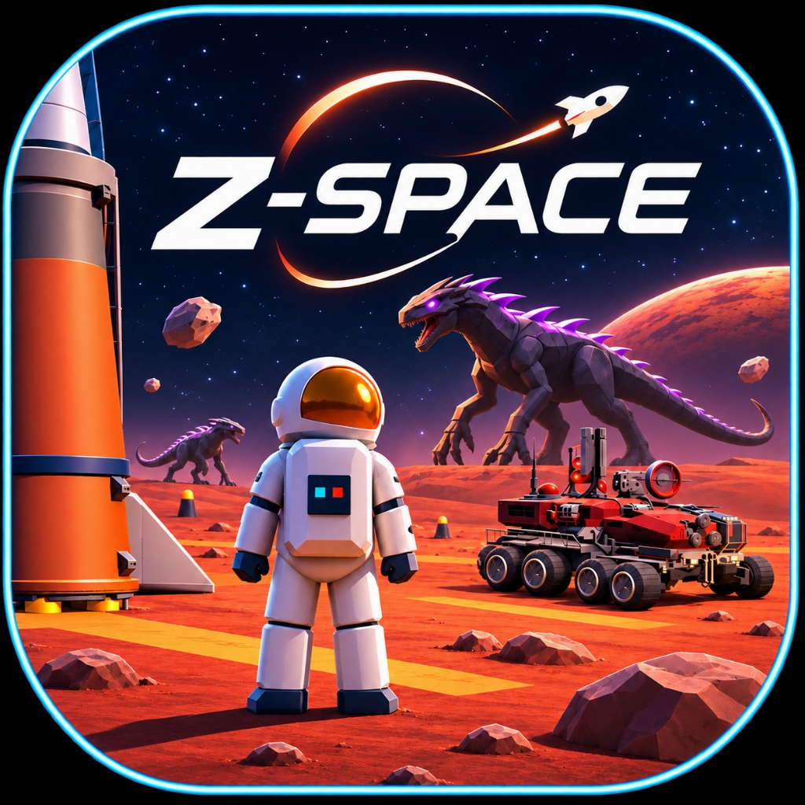

<p align="center">
  
</p>

<h1 align="center">🚀 Z-SPACE | 3D Space Exploration Simulator</h1>

<p align="center">
  <b>Created & Developed by <a href="https://zeesu-royalist.vercel.app">Zeesu Royalist</a></b><br>
  <span>Portfolio & Projects: <a href="https://zeesu-royalist.vercel.app">zeesu-royalist.vercel.app</a></span>
</p>

<p align="center">
  A high-performance, realistic interplanetary spaceflight and planetary exploration simulator built with React, Three.js, React Three Fiber, and TypeScript.
</p>

---

## 🌌 Overview

**Z-SPACE** takes you on a multi-planetary voyage across the solar system:
- **Earth Cosmodrome**: Launch pad with Soviet Buran-Energia rocket, launch tower, Stormchaser explorer car, and commander astronaut.
- **Lunar Base Alpha**: Low-gravity surface exploration with the Lunar 4x4 Rover, mission flags, and Apollo-style landing pad.
- **Mars Ares Base**: High-stakes red planet terrain with the Martian Exploration Rover, plasma rifle tactical weaponry, and hostile Xenomorph swarms.

---

## 🎮 Key Controls & Keybindings

### 🚀 Rocket Controls
- **Launch Rocket**: `[F]` or `[Space]` (on launchpad)
- **Select Destination**: Launch dialog allows choosing Earth, Moon, or Mars
- **Steer Pitch & Yaw**: `[W]` / `[S]` (Pitch Up/Down), `[A]` / `[D]` (Yaw Left/Right)
- **Throttle**: `[Shift]` (+15%), `[Ctrl]` (-15%)
- **Autopilot Cruise**: `[T]` (orbital rendezvous and automated touchdown alignment)
- **Emergency Restart**: `[R]` (returns to Earth launchpad)

### 👨‍🚀 Planetary Astronaut Controls
- **Enter / Exit Vehicle**: `[E]` (board or step out of Rocket and Rover)
- **Movement**: `[W]` / `[A]` / `[S]` / `[D]`
- **Planetary Hop / Jump**: `[Space]` (conforms to Earth 1.0G, Moon 0.17G, and Mars 0.38G physics)
- **Plasma Rifle Shoot**: `[Q]` (fires rapid tactical plasma bolts with targeting assist)
- **Suit Life Support**: Real-time HUD telemetry; taking alien melee hits reduces integrity. Boarding vehicles instantly restores health to 100%.

### 🚙 Rover Controls
- **Drive**: `[W]` / `[S]` (Accelerate / Reverse)
- **Steer**: `[A]` / `[D]` (Smooth wheel steering with terrain suspension conforming)
- **Exit Rover**: `[E]`

---

## 🛠️ Tech Stack

- **Framework**: React 18 & TypeScript
- **3D Graphics Engine**: Three.js, `@react-three/fiber`, `@react-three/drei`
- **Audio**: Web Audio API (procedural zero-latency synthesizer)
- **Styling**: Tailwind CSS
- **Bundler**: Vite 5

---

## 📦 Local Development

1. **Clone Repository**:
   ```bash
   git clone https://github.com/zeesu-royalist/Gravity_Game.git
   cd Gravity_Game
   ```

2. **Install Dependencies**:
   ```bash
   npm install
   ```

3. **Start Development Server**:
   ```bash
   npm run dev
   ```
   Open `http://localhost:3000` in your browser.

4. **Production Build**:
   ```bash
   npm run build
   ```

---

## 🌐 Deployment

### Deploy to Vercel (Recommended)
1. Push your repository to GitHub.
2. Import project into [Vercel](https://vercel.com).
3. The included `vercel.json` automatically configures Vite build outputs, asset caching for 3D `.glb` models, and SPA routing.

### Deploy to Netlify
1. Connect repository in [Netlify](https://netlify.com).
2. Build command: `npm run build`
3. Publish directory: `dist`
4. The included `public/_redirects` ensures seamless SPA routing.

---

## 📄 License & Credits

MIT License. Designed and Developed with ❤️ by **[Zeesu Royalist](https://zeesu-royalist.vercel.app)**.

